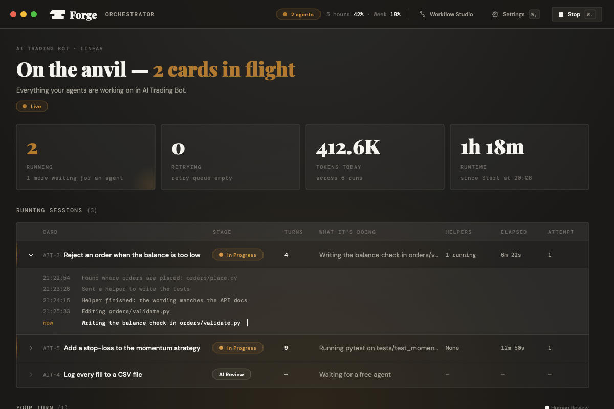
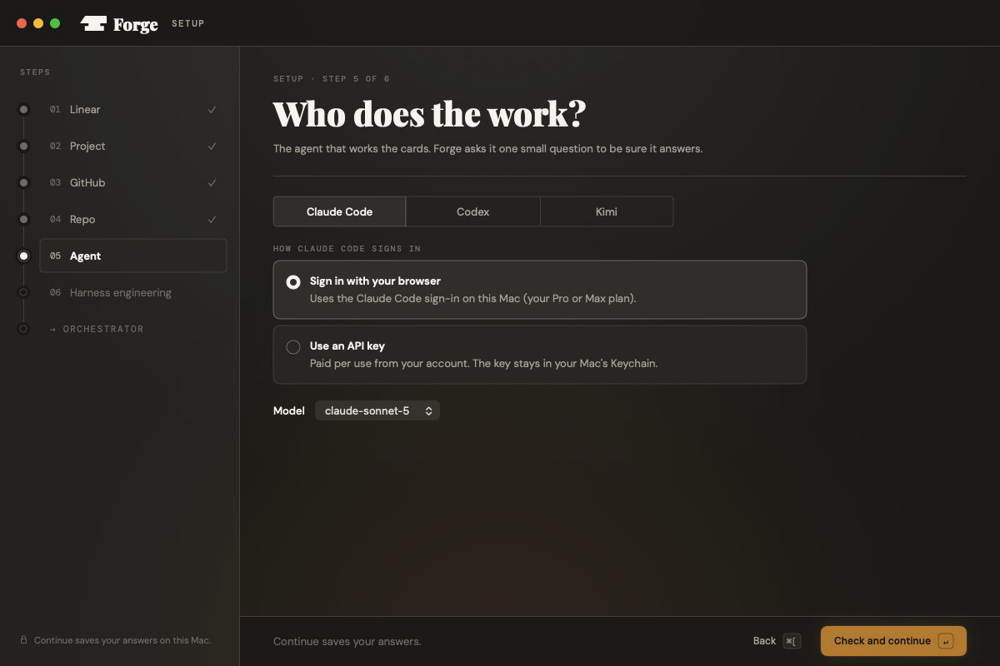
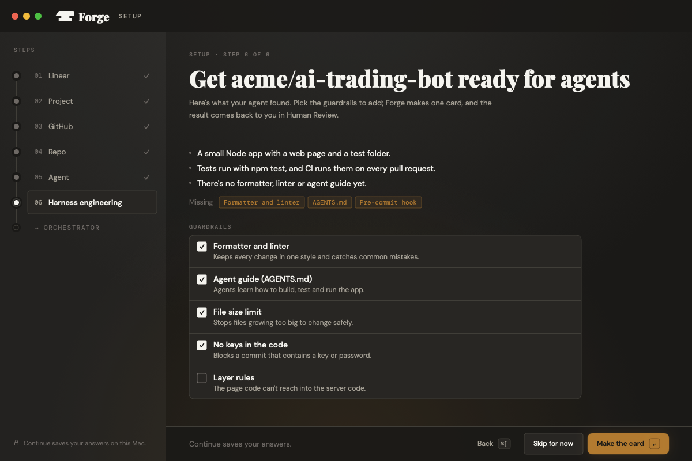
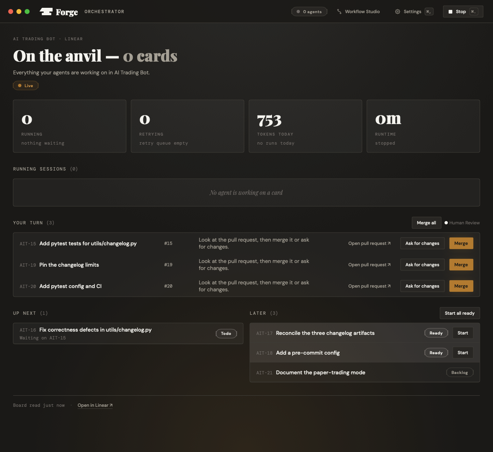
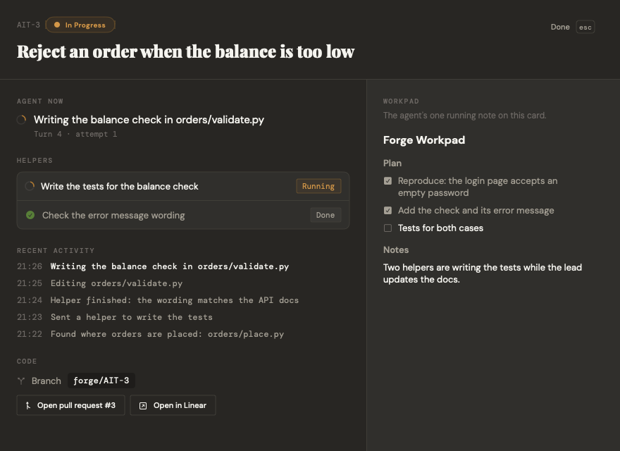
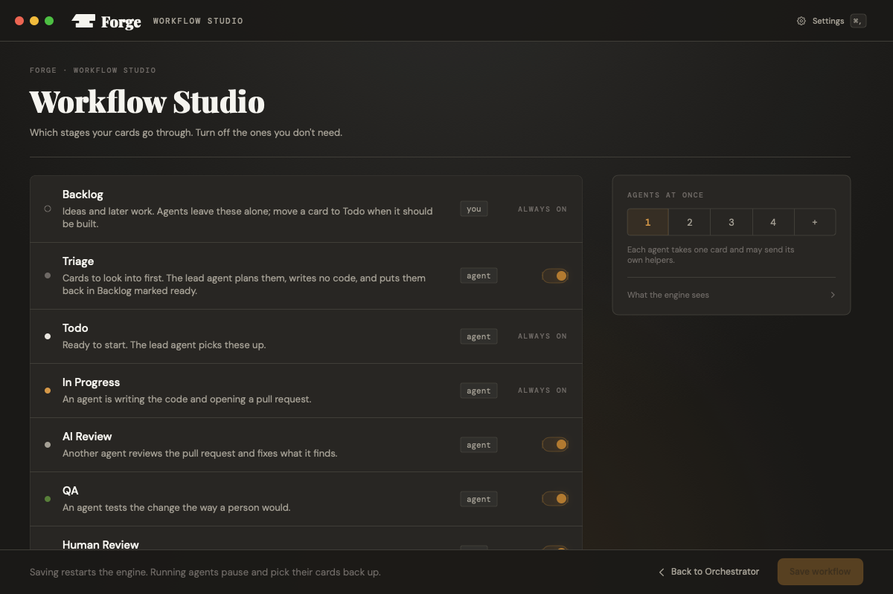

# Forge Desktop

**Your own AI software agency, running on your Mac.** Hand it the work, press Start, and AI coding
agents plan, build, review and test each task, then bring you a pull request ready to merge.

You write the tasks. Forge's lead agent picks up what's ready, writes the code on its own branch,
opens a pull request, has it reviewed and tested by other agents, and hands it back to you. You read
the pull request and press Merge, or ask for changes. That's the loop.

https://github.com/user-attachments/assets/bb98390c-23dd-4307-9dac-6706f35f1ef6

A one-minute tour, with sound. [Download it in full quality](docs/promo/forge-desktop-promo.mp4).

- A native Mac app (SwiftUI), never a browser page.
- Works with the agent you already use: Claude Code, Codex or Kimi.
- Your keys live in your Mac's Keychain, nowhere else.
- Commits go out under your name, signed, the way you chose in setup.

**Status:** early, in daily use. Newest version: [latest release](https://github.com/Donnadieu/forge-desktop/releases/latest).

## Install

You need a Mac with Apple Silicon and macOS 14 or newer.

1. Download `Forge.dmg` from the [latest release](https://github.com/Donnadieu/forge-desktop/releases/latest). It's signed and
   notarized by Apple, so it opens like any other app.
2. Drag **Forge** into **Applications** and open it.
3. Have these ready (setup checks each one and tells you what's missing):
   - somewhere for the tasks: a **Linear** project (and a personal API key from Linear's
     settings), a **Basecamp** project with a card table, or **GitHub Issues** on a GitHub
     project (for both, you sign in through the browser),
   - the **GitHub CLI** (`gh`) on this Mac; Forge runs GitHub's sign-in for you inside the app,
   - one coding agent: **Claude Code** (your Pro or Max plan, or an API key), **Codex**
     (browser sign-in or an OpenAI key), or **Kimi** (a Moonshot key).
4. Follow the six setup screens. Forge saves each answer as you go, so you can quit and pick up
   where you left off.

Forge updates itself: when a new release is out it offers to update, checks the download's
signature, lets running agents wrap up, swaps the app and reopens it.

## Features

**Setup in six screens, one question each**

1. **Cards:** pick Linear, Basecamp or GitHub Issues. Linear: paste your key once. Basecamp and
   GitHub: approve a short code in your browser. Either way the sign-in goes into the Keychain.
2. **Project:** pick the project (on Basecamp, its card table; on GitHub, the project whose Status
   field holds the columns, and the repo new issues go to). Forge explains the pipeline
   and offers to add any missing statuses or columns (Backlog, Triage, Todo, In Progress, AI Review, QA, Human Review, Rework, Merging, Done).
3. **GitHub:** sign in and choose who authors and signs the commits: you with a key Forge makes
   and registers, your own GPG key, or unsigned (with a warning).
4. **Repo:** pick the repo; Forge checks you can push to it.
5. **Agent:** choose who does the work and how it signs in, checked with one real call.
6. **Harness engineering:** the agent reads your repo and suggests guardrails (formatter, linter,
   agent guide, file size limit, no keys in the code). Tick the ones you want and Forge makes one
   card for them, which comes back to you as a pull request.

**The Orchestrator** (the main screen)

- What's in flight, with four numbers: running, retrying, tokens today, runtime.
- **Running sessions:** each agent's card, stage, turns and what it's doing. Open a row to follow
  it line by line.
- **Your turn:** pull requests waiting in Human Review, with Open pull request, **Ask for changes**
  and **Merge**. Several waiting? **Merge all**, after a confirm that lists them.
- **Up next** and **Later:** what's queued, which card is waiting on another, and cards triage
  marked Ready, each with **Start** (or **Start all ready**).
- **Start** and **Stop** always in reach, and your Claude usage (5-hour and weekly) in the top bar.

**Card detail:** what the agent is doing now, the helpers it sent, recent activity, its running
notes (the workpad), the branch, and links to the pull request and the card in Linear, Basecamp or GitHub.

**Workflow Studio:** turn optional stages on or off (Triage, AI Review, QA, Human Review, Merging)
and set how many agents work at once. Saving restarts the engine; agents pick their cards back up.

**Settings:** everything Forge connects to (Linear, Basecamp or GitHub Issues, project, GitHub, repo, signing, agent), each
with Change to reopen that setup step.

**Gets you unstuck by itself:** if an agent's sign-in runs out, Forge notices from the failure and
opens the sign-in for you. A failed check always shows the one button that fixes it.

The screenshots are drawn by the app itself (`Forge --render-screens <folder>`, version 0.2.11)
with its built-in sample board, so no real project data appears in them.

## How it works

Two parts in one app: the Mac window (Swift) and the board engine (TypeScript on a bundled Node),
which runs beside it and is copied from Forge; see [engine/README.md](engine/README.md). The engine
reads your Linear, Basecamp or GitHub Issues board, gives each card its own folder and branch, runs the agent there, and moves
the card through the pipeline. The window shows the engine's state and sends your moves back.
More in [docs/ARCHITECTURE.md](docs/ARCHITECTURE.md) and [docs/PRODUCT_SENSE.md](docs/PRODUCT_SENSE.md).

## Build from source

    cp .env.example .env    # fill in the commit identity (contributors only)
    make hooks              # once per clone
    make build              # build/app.noindex/Forge.app
    make check              # the whole gate

Needs macOS 14+ on Apple Silicon, the Xcode command line tools, and Node 22 + pnpm for the engine.
Releasing: [docs/RELEASING.md](docs/RELEASING.md). Agents and contributors start at
[AGENTS.md](AGENTS.md).

## License

Apache-2.0. See [LICENSE](LICENSE) and [NOTICE](NOTICE).
