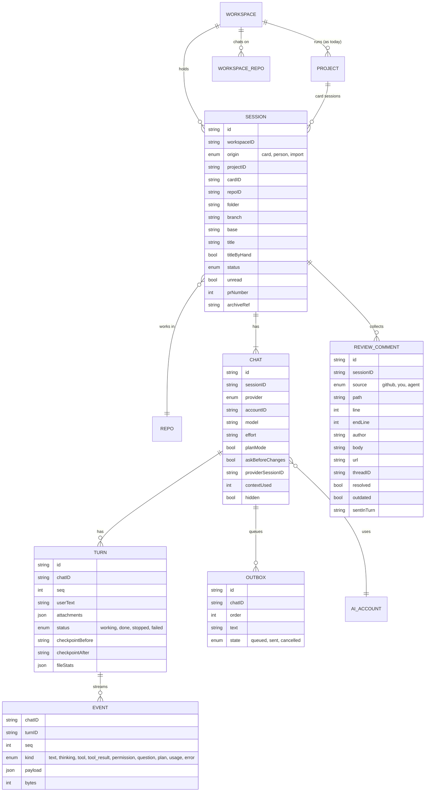

# Sessions: design

Status: **design, not built.** Omar's request (Nov 9, 2026): bring the way he works in Conductor into Forge Desktop
instead of building a separate app, because Conductor is shutting down after joining Meta (cloud off Nov 20, 2026; the
Mac app stops early 2027). Screens in Claude Design (link in section 9), pictures in `docs/design/sessions/`.

## 1. The idea in one paragraph

A workspace holds **sessions**. A session is one stream of work on one repo: its own folder and branch, its
conversation with an agent, its diff and its pull request. Some sessions Forge starts by itself from a tracker card
(autopilot, as today). Some the person starts and chats with, turn by turn, like Conductor. The person can open a card's
running session and steer it. Several conversations stay open side by side in one workspace. A workspace with no
tracker (Omar's "personal") becomes useful on day one: today it only shows running sessions and he can't start one.

## 2. How Omar uses Conductor (his data, read-only, Nov 9)

| Measure | Value | What it means here |
|---|---|---|
| Agent | Claude Code in 3,309 of 3,310 chats | Claude first; Codex and Kimi come along because Forge already runs them |
| Model and effort | Opus 1M on high effort (2,945 chats) | Default for a new chat: Opus 5.5 · 1M, High |
| Chats per workspace | about 2.4, up to 46 | A session holds several chats (tabs) |
| Longest chat | 11,663 messages; 95% of chats under 1,634; median 297 | The transcript must stay smooth past 10,000 items (section 7) |
| Largest single message | 4.4 MB | Big tool outputs are folded and loaded on demand |
| GitHub review comments pulled into chats | 2,430 of 2,557 diff comments | "Pull PR review comments" is a V1 must, not P1 |
| Plan mode | 142 chats | Keep plan mode |
| Tool approvals | off | Agents run with full permissions by default; asking stays an option |
| Setup, run, archive scripts | never set, in any repo | Dropped |
| Ports, pins, sections, big terminal | never used | Dropped |
| Open now | 21 workspaces on 9 repos, 67 chats (39 visible), 45,888 messages | One-step import (section 8) |

## 3. The 96 Conductor must-haves, mapped onto Forge

IDs are from the Conductor spec (`Donnadieu/tandem`, `docs/spec.md`). **Have** = Forge does it today. **New** = V1 of
this design. **Later** = after V1. **Drop** = not building it.

| Area | IDs | Forge today | Plan |
|---|---|---|---|
| Setup checks, agent sign-ins | ON-01, ON-04 | Setup checks GitHub and each provider; many accounts per provider (0.2.17) | **Have** |
| Pinned agent copies | ON-02 | Uses the Mac's own `claude`/`codex` on the login PATH | **Drop** (keep PATH; Forge's checks already catch a broken one) |
| Repos | RP-01, RP-04 | Repos exist only behind a tracker project | **New:** a workspace can list repos directly, each with an optional local folder |
| New session | WS-01, WS-03 | none | **New:** "New session": repo, branch from, first message, model and effort, send |
| From PR, branch or issue | WS-02 | Cards come from Linear, Basecamp, GitHub Issues | **New:** start from an open PR or a branch; from an issue = start from a card (Have) |
| Folder names, friendly links | WS-05, WS-08 | Card folders are named by card id | **New:** session folders get a short readable name; no symlinks (Forge shows the name itself) |
| Sidebar title, rename | WS-06, WS-07 | Card title | **New:** PR title, else the agent-named branch; a rename by hand sticks |
| Status, unread | WS-09, WS-10 | Card stage pills, Your turn table | **New:** session status (Working, Needs you, Ready for review, Merged) and an unread dot |
| Switch with keys | WS-17 | none | **New:** ⌘1 to ⌘9, ⌘⌥↑/↓ |
| Worktrees | WT-01 to WT-05, WT-07 | Shallow clone per card | **New:** a worktree from the repo's local folder (or Forge's own clone), fetched first, branch `<github login>/<slug>` with no double prefix, `.env*` copied |
| Setup script on create | WT-06 | none | **Drop** (never used) |
| Archive, restore, archive on merge | WT-08 to WT-10 | Cards end in Done | **New:** Archive (snapshot to a private ref, remove the folder, keep chats), History, restore |
| Claude Code streaming session | AG-01 | Engine runs Claude Code with stream-json, one process per card, effort flag | **Have** the runner; **New:** full event stream kept, permission prompts, resume after restart |
| Codex app-server | AG-02 | Engine speaks the Codex app-server protocol | **Have**; **New:** steer and interrupt (`turn/steer`, `turn/interrupt`) |
| Model and effort per chat | AG-05, AG-06 | Model per project and per role | **New:** per chat picker (⌘/), effort (⌘⇧/), workspace default |
| Plan mode | AG-07 | none | **New:** ⇧Tab, plan shown as a document, Approve |
| Tool approvals | AG-09 | Always bypass | **New:** off by default (as Omar runs today), "Ask before changes" per chat |
| Forge's instructions, repo skills | AG-10, AG-11 | Lead instructions and bundled skills copied into card folders | **Have**; **New:** a short chat preamble (no pipeline rules in a person's chat) |
| Context meter | AG-14 | Tokens today in stats | **New:** per chat context use and "Compacting…" |
| Transcript, rendering | CH-01, CH-02 | Last 5 activity lines per card | **New:** native transcript (section 7) |
| Composer | CH-03 | none | **New:** multi-line, paste images and text, @file; @terminal dropped |
| Queue, steer, stop | CH-04 to CH-06 | Stop is per engine | **New** (section 6) |
| Agent questions, plans | CH-07, CH-08 | none | **New:** buttons for questions, plan document |
| Chat tabs | CH-09 | none | **New:** tabs inside a session (⌘T, ⌘W) |
| Checkpoints and revert per turn | CP-01 to CP-05 | none | **New**, step 4 |
| Diff viewer, comments | DV-01, DV-02, DV-04 | none (a link to the PR) | **New:** diff panel, unified first; comment on a line, send to the chat |
| GitHub review comments | DV-06 (P1 in the spec) | none | **New, V1:** "Pull PR review comments into this chat" |
| Review action | DV-10 | AI Review stage on cards (`code-review-nuclear`) | **New:** "Review" runs the same review skill on the session's diff |
| Git panel | GT-01 to GT-04 | Agents commit with the `commit` skill | **New:** status line, ahead/behind, one suggested next button (Commit, Push, Create PR, Fix errors, Merge) |
| PR flow | PR-01 to PR-05 | Cards open PRs; Orchestrator has Merge | **New** for sessions: Create PR, PR line, checks, Fix errors, Merge |
| Scripts and actions | SC-01 to SC-05, SC-07 | none | **Drop** (never used) |
| Login-shell env, workspace env | SC-09, SC-10 | Agents get the login-shell PATH | **Have** PATH; **New:** `FORGE_SESSION_*` variables |
| Ports | PT-01 | none | **Drop** |
| Terminal panel | TM-01 to TM-03, TM-05 | none (no web views, no terminal emulator) | **Drop** for V1: "Open in Cursor" and "Open in Terminal" buttons instead |
| Many at once | MA-01, MA-02 | Many cards, many workspaces at once | **Have** for cards; **New:** several chats on one session's branch |
| Next needing you | MA-03 | Your turn table | **New:** ⌘⌥L jumps to the next chat waiting on you, across workspaces |
| Notifications | NT-01 | none | **New:** dot, macOS notification, sound |
| Layout, sidebar, history | NV-01 to NV-03 | Orchestrator, Workflow Studio, Settings | **New:** the Sessions screen (section 9) |
| Command palette | NV-04 | none | **Later** |
| TOML settings layers, settings screen | ST-01 to ST-06 | `store.json`, Settings per workspace | **Drop** the files; **New:** session defaults (model, effort, branch prefix) in workspace Settings |
| Shortcuts | KB-01 to KB-03 | Menu shortcuts for a few actions | **New:** the keys Omar uses, kept identical (list in section 6); no rebinding screen |
| MCP config, GitHub | MC-01, MC-03 | Harness reads its own MCP config; `gh` accounts per workspace | **Have** |
| Local data, never lose a message, survive restarts | DT-01 to DT-03 | Engine SQLite, drain on quit | **New:** outbox, event log, resume (section 6) |
| Import from Conductor | DT-05 (P1 in the spec) | none | **New, V1** (section 8) |

Net: about 15 must-haves are already covered by Forge, about 15 are dropped because Omar never used them, and the rest
are new. The biggest new pieces are the chat itself, the diff and PR panel, and the import.

## 4. Words on screen

Session (one piece of work on one repo: its folder, branch, chats, diff, PR), chat (one conversation inside it),
"Started by Forge" / "Started by you" / "Imported", Steer, Stop, Hand back to Forge, Needs you. Never: terminal, CLI,
stream, token (the `ui-jargon` lint applies). "Running sessions" on the Orchestrator keeps its name: those rows are
sessions Forge started.

## 5. Data model

- **Workspace (changed):** gains `repos` (repos it chats on without a tracker, each with an optional local folder) and
  `sessionDefaults` {account, model, effort, branch prefix}. Its projects, connections and Workflow Studio settings stay
  as they are. Omar's "personal" gets his repos here.
- **Session (new):** `origin = card` ties it to a project's card (the engine's card folder and branch); `person` is one
  the person started; `import` came from Conductor and points at Conductor's existing folder.
- **Chat, Turn, Event (new):** one row per turn (what the list shows), its events append-only. Big payloads (a 4 MB
  tool result) are stored once and the event keeps only a 2 KB preview plus its size.
- **Where it lives:** in a new SQLite file, `sessions.sqlite`, written only by the sessions host (section 6). The app
  reads through the host's local API, as it reads the board today. `store.json` keeps only the workspace fields above.
  Card sessions keep their events in each project engine's own `forge.sqlite`, same tables.

## 6. How a chat runs

### Where
- **A sessions host:** the same bundled engine started in a second mode (`node dist/index.js --sessions`, home
  `Forge/sessions/`), one per Mac, started when the first session opens. New engine module `src/sessions/` (layer 3,
  beside `orchestrator/`), reusing `agent/` (Claude Code, Codex, Kimi runners), `process/`, `workspace/` (skills copy,
  git identity) and `store/`. Same 127.0.0.1 port plus launch token, same live WebSocket.
- **Card sessions** stay in their project's engine. That engine gains: keep the full event stream per card run, and
  four routes (below). The app shows both through one `SessionFeed`, so the chat screen doesn't care where a session runs.

### Local API (sessions host; card engines get the `cards/<id>/…` four)
`GET /api/v1/sessions?workspace=` · `POST /api/v1/sessions` (repo, base, first message, account, model, effort) ·
`GET /api/v1/chats/<id>/turns?before=<seq>&limit=50` · `POST /api/v1/chats/<id>/messages` {text, attachments,
mode: queue | steer} · `POST /api/v1/chats/<id>/stop` · `POST /api/v1/chats/<id>/permission` · `POST
/api/v1/chats/<id>/answer` · `PATCH /api/v1/chats/<id>` {model, effort, planMode} · `GET /api/v1/sessions/<id>/diff` ·
`POST /api/v1/sessions/<id>/review-comments/pull` · `POST /api/v1/sessions/<id>/archive` · `WS /api/v1/live?chat=`.
Card engines: `GET cards/<id>/turns`, `POST cards/<id>/message`, `POST cards/<id>/stop-turn`, `POST
cards/<id>/hand-back`.

### Claude Code (most of Omar's work)
One long-lived process per chat, as the engine's runner does today: `claude -p --input-format stream-json
--output-format stream-json --verbose --session-id <id> --model <m> --effort <e>`, plus
`--include-partial-messages` for text as it's written. Proven on this Mac with Claude Code 2.1.319 (Nov 9):

| Need | How | Proven |
|---|---|---|
| Steer | Write a `user` message to the process while a turn runs. Claude Code reads it at its next step (after the tool that's running) and the same turn changes course. | Yes: a "skip the second command, say BANANA" sent mid-turn ended that turn with "BANANA" |
| Stop | `control_request` `{subtype: "interrupt"}`. The turn ends at once (`error_during_execution`), the process stays alive for the next message. | Yes, under 0.1 s |
| Change model | `control_request` `{subtype: "set_model"}`, live, no restart | Yes (haiku to sonnet) |
| Change effort | Between turns: end the process, start again with `--resume <id> --effort <new>` | Flag listed in `claude --help` |
| Permission prompts | `--permission-prompt-tool stdio` with `--permission-mode default`: Claude Code sends `control_request` `can_use_tool` (tool, input, suggestions); answer allow or deny | Yes: a Write waited for our "allow" |
| Plan mode | `--permission-mode plan`; the plan arrives as the `ExitPlanMode` tool; Approve answers it and switches mode | Not yet |
| Agent questions | The `AskUserQuestion` tool's input becomes buttons; the answer goes back as its result | Not yet |
| Resume after a restart or crash | `--resume <providerSessionID>` in the same folder and with the same `CLAUDE_CONFIG_DIR` (the account's folder) | Used by the engine today |
| Context meter | `usage` on each assistant message against the model's window (1M) | Engine already sums usage |

Queue: a message sent while a turn runs is **steered by default** (Omar's Conductor habit: Enter steers). ⌥Enter
queues it for after the turn instead. Every outgoing message is written to the outbox before it's sent; every event is
written before the app is told; on restart the host replays the outbox and resumes each chat that was mid-turn, and that
turn is marked "Interrupted, resumed".

### Codex and Kimi
- **Codex** (already on the app-server protocol in the engine): steer = `turn/steer`, stop = `turn/interrupt`, resume =
  `thread/resume`, models = `model/list`, effort per `turn/start`, approvals arrive as requests to answer, review =
  `review/start`. All listed by `codex app-server generate-json-schema` (codex-cli 0.153).
- **Kimi** runs one process per turn (`kimi -p … -r <session>`): no steer (messages queue for the next turn), Stop ends
  the process, effort hidden. The picker greys out what a provider can't do.

### Card sessions: watch, steer, take the wheel
- Opening a running card shows its live transcript (same screen as a person's chat) with "Started by Forge · AIT-3 · In
  Progress".
- **Steer** writes into the card's running process, as above. The pipeline goes on.
- **Stop** interrupts the turn and puts the card **hands-on**: the engine's runner stops sending its own "continue"
  turns, keeps the card claimed and the process alive, and the person chats. **Hand back to Forge** clears hands-on and
  the runner carries on from where the chat left it. Hands-on is saved in the engine's store, so a restart keeps it.
  Engine change, with a test in the engine suite and a PROVENANCE row.

### Diff and review
- The host computes the diff with git: the branch against `origin/<base>` plus uncommitted changes, file list with
  added/removed counts, hunks on demand per file (a 5,000-line diff never crosses as one blob).
- Comment on a line or a range: the comment joins the composer as an attachment; Send puts it in the next message.
- **Review** runs the bundled `code-review-nuclear` skill in a new chat tab of the same session, so the review lands as
  comments on the diff.

### Create PR
"Create PR" (⌘⇧P) sends Forge's create-PR prompt to the chat; the agent pushes with the workspace's GitHub account and
signing (as cards do) and opens it with `gh`. The host links the PR by branch (`gh pr view --json number,state,…`) and
the session header shows "PR #212 · Open · 2 checks failing". Fix errors (⌘⇧X) sends the failing checks' logs. Merge
(⌘⇧M) asks first, then `gh pr merge`, and archives the session when it merged.

### Pull GitHub review comments into a chat
"Pull PR review comments" (in the PR line and in the composer's + menu) reads the PR's review threads through GitHub's
GraphQL `reviewThreads` (path, line, author, body, url, `isResolved`, `isOutdated`) with the repo's GitHub account. A
sheet lists the unresolved threads, ticked; outdated ones unticked and marked. "Add 6 comments to this chat" puts them
into the composer as one block (file:line, author, comment, link), so the person can add a line before sending.
Each comment remembers the turn it went out in, so pulling again offers only new ones.

### Model and effort picker
Per chat, in the composer: provider and account (from the workspace), model (Claude: Opus 5.5 · 1M, Opus 5.5, Sonnet 5.5,
Haiku; Codex from `model/list`), effort (Low, Medium, High, Extra high, Max). Default = the workspace's session
default, Omar's set to Opus 5.5 · 1M, High. A change applies from the next turn and is written in the transcript.

### Keys (Conductor's, so Omar's hands keep working)
⌘N new session · ⌘T new chat · ⌘W close chat · ⌘L focus composer · ⌘/ model · ⌘⇧/ effort · ⇧Tab plan mode · ⌘⇧Enter
approve plan · ⌘⇧⌫ stop · ⌘⇧D diff · ⌘⇧P create PR · ⌘⇧X fix errors · ⌘⇧M merge · ⌘⇧A archive · ⌘O open in Cursor ·
⌘1 to ⌘9 sessions · ⌘⌥L next chat needing you. Each is a SwiftUI menu command, so the menu bar lists them.

## 7. Long transcripts in SwiftUI, without a web view

Target, from Omar's data: a chat of 11,663 messages scrolls smoothly, opens in under half a second, and stays under
300 MB while a turn streams.

1. **One row per turn**, not per event (CH-01). A finished turn is immutable: its view model is built once and its
   height cached. Only the streaming turn changes.
2. **A window, not the whole chat.** Load the last 50 turns; load 50 older ones when the top comes near
   (`turns?before=`). Keep at most ~300 turns of views alive; older ones drop back to their cached text.
3. **Native list with recycling.** SwiftUI `List` on macOS is backed by `NSTableView` and recycles rows; a plain
   `ScrollView` + `LazyVStack` keeps every row it ever built, so it isn't used for transcripts. Stick to the bottom with
   `defaultScrollAnchor(.bottom)` while the agent writes, keep the position when older turns arrive with
   `scrollPosition(id:)`, and show "Jump to latest" when scrolled up. If the spike shows `List` stuttering at 10,000
   rows, the fallback is an `NSTableView` in an `NSViewRepresentable` with the same SwiftUI row views
   (`NSHostingView`), still fully native.
4. **Rendering off the main thread.** Markdown becomes an `AttributedString` and code gets its colours on a background
   actor, cached by turn id and content hash. Rows never measure themselves with `GeometryReader`.
5. **Streaming at 20 frames a second.** Text deltas gather in the host-feed actor and reach the screen at most every
   50 ms, touching only the live turn's `@Observable` model.
6. **Folded by default.** Tool calls show one line ("Edited orders/validate.py +12 −3", "Ran tests · 42 passed"); the
   body loads when opened. A tool output over 200 lines shows its first 40 and "Show all 1,284 lines", which opens in an
   `NSTextView` (built for big text). Thinking is one folded line.
7. **Diffs** use fixed-height monospaced rows in their own `List`, so a 5,000-line diff costs the same as a short one.
8. **Proof before building on it:** a `--render-screens` scene and a selftest that load a synthetic 12,000-turn chat
   and 5,000-line diff, measure open time and memory, and fail over budget.

## 8. Import from Conductor

"Import from Conductor" (Sessions screen, empty state and the + menu) reads Conductor's database read-only (a copy
opened immutable; Conductor is never written to) and shows what it found: open workspaces grouped by repo, each with its
chats and PR title, all ticked. The person picks the Forge workspace for each repo ("personal" by default; the
ConstructEase repo to "ConstructEase Rails") and presses "Import 21 sessions".

- Each open Conductor workspace becomes a session with `origin = import`, its **folder left where it is** (Forge never
  moves or deletes it), its branch, PR and title. Each visible chat becomes a chat with its history copied in (as
  turns and events), its model and effort, and its Claude session id.
- **Resume:** Claude Code keeps its transcript under the login folder it ran with. Conductor ran on the Mac's own
  Claude login (`~/.claude`), Forge's accounts run with their own folder. Import copies each chat's transcript file into
  the chosen account's folder (same path inside), so the next message resumes the same conversation.
- Pending diff comments come along. Archived workspaces (1,318) aren't imported; their chats stay readable in
  Conductor until it closes. A second import adds only what's new.
- Warning on the sheet, one line: "Don't send to the same chat from Conductor and Forge at once."

## 9. Screens

Two directions, made in Claude Design with the Forge Design System, in Forge's current look. The "before" picture is
today's Orchestrator and card detail ([before 1](sessions/00-before-orchestrator.png),
[before 2](sessions/00-before-card.png)). Frames are in `docs/design/sessions/`:

| Frame | Direction A: "Chat first" (a Sessions screen, three panes) | Direction B: "Board first" (Orchestrator-style tables, a chat is its own page) |
|---|---|---|
| 1 | [a1](sessions/a1-session-list-new-session.png) Session list + New session | [b1](sessions/b1-session-tables-new-session.png) Session tables + New session sheet |
| 2 | [a2](sessions/a2-chat.png) Chat: streaming, tools folded, diff panel, model picker | [b2](sessions/b2-chat.png) Chat page, diff as a side sheet |
| 3 | [a3](sessions/a3-card-session.png) A card's running session: steer, take the wheel | [b3](sessions/b3-card-session.png) Same as a page, opened from Running sessions ([inset](sessions/b3-card-session-open-from-orchestrator.png)) |
| 4 | [a4](sessions/a4-side-by-side.png) Two chats side by side | [b4](sessions/b4-tabs-three-across.png) Chats as tabs, three across |
| 5 | [a5](sessions/a5-pull-review-comments.png) Pull PR review comments (sheet) | [b5](sessions/b5-pull-review-comments.png) Pull PR review comments (composer tray) |
| 6 | [a6](sessions/a6-import-conductor.png) Import from Conductor (sheet) | [b6](sessions/b6-import-conductor.png) Import from Conductor (page) |

Claude Design project: https://claude.ai/design/p/f4c92c06-8b0e-46d1-a6b9-cd2b0499b4d9 (file and tokens per frame in
`TOKENS-USED.md`). All frames in one PDF: [sessions/sessions-design.pdf](sessions/sessions-design.pdf).

## 10. Build order (after Omar picks a direction)

1. **Spike** (no screen change): the 12,000-turn transcript and 5,000-line diff budget test (section 7), and the
   sessions host answering `POST /sessions` + one streamed Claude Code turn with steer and stop. Go or no-go on `List`.
2. **Sessions host + Sessions screen**: workspace repos, New session, the chat (stream, folded tools, steer, queue,
   stop, model and effort, context meter, permission prompts, questions, plan mode), several chats per session,
   notifications, resume after restart.
3. **Diff, PR and review comments**: diff panel, line comments, Create PR, PR line with checks, Fix errors, Merge,
   Pull PR review comments, Review, Archive and History.
4. **Checkpoints** per turn with revert.
5. **Card sessions**: the card engine keeps the event stream; watch, steer, Stop to hands-on, Hand back to Forge.
6. **Import from Conductor.**

Each step is its own PR with a render of every new screen and a selftest; release once the whole plan is built, as
with workspaces.

## 11. Open questions (with a recommendation each)

1. **Enter while the agent works: steer or queue?** Recommend steer (Conductor's default, which he's used to);
   ⌥Enter queues.
2. **Do chats count toward "Agents at once, across all workspaces"?** Recommend no: the ceiling keeps autopilot from
   swamping the Mac; a person's chats are always allowed, and the usage meter shows both.
3. **Session folders:** a worktree from his local checkout when the repo has one (fast, `.env` copied), else Forge's own
   clone. Recommend yes.
4. **Terminal panel:** dropped for V1 ("Open in Terminal" instead), since a native terminal needs a terminal engine
   Forge doesn't ship. Recommend revisit only if he misses it.
5. **Import target:** each Conductor repo to a workspace, guessed by repo owner, editable on the sheet. Recommend yes.
