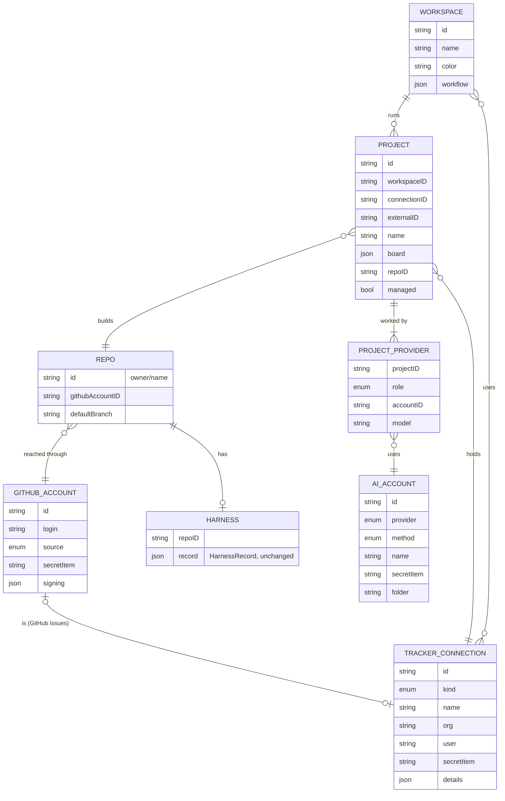

# Workspaces: design

Status: **step 1 built** (workspaces, switcher, several connections per tracker kind, GitHub accounts, the project
list and repos per project, Harness engineering per repo; one project runs at a time). Steps 2 and 3 not built. The request and requirements: [workspaces.md](workspaces.md). Screens made in Claude
Design (link in section 6), PNGs in `docs/design/workspaces/`.

## 1. The name

| Option | Why it fits | Why not |
|---|---|---|
| **Workspace** (recommended) | Everyone knows it from Slack, Linear, VS Code: "a place with its own stuff". Neutral: works for a client (ConstructEase), a company (Forge Factory) or side projects. | Linear also says "workspace" for its organisation. Forge already calls Linear's one an organisation ("Linear · Forge Factory"), so they don't clash on screen. The engine's per-card folders are also called workspaces in code; that word never reaches the screen. |
| Client | Matches the pitch, "your own AI software agency": an agency has clients. | Wrong for your own products (Forge Factory isn't a client) and for side projects. |
| Company | Plain, matches how Omar thinks of his work today (ConstructEase, Forge Factory). | Too heavy for "Side projects", and two workspaces for one company read oddly. |

Recommendation: **Workspace**.

## 2. The model

What a workspace holds, and what belongs to the Mac (signed in once, usable by any workspace):

- **On this Mac (shared):** tracker connections, GitHub accounts, intelligence provider accounts. Each is one sign-in or
  key, with its own Keychain item. A workspace picks which ones it uses; it never owns the secret.
- **In a workspace:** its projects (picked under its tracker connections), each project's repo, each project's
  intelligence providers with their roles and models, and its Workflow Studio settings.
- **Per repo:** Harness engineering (the guardrail record that `SetupChoices.harness` keeps today), and which GitHub
  account reaches it.

A PNG of the same diagram for reading on a phone: [workspaces/m1-data-model.png](workspaces/m1-data-model.png).

### Tables (in `store.json`, version 2)

Forge keeps JSON tables, as 0.2.17 decided (one writer, small tables); `setup.json` stays the running project's working
copy so the engine and today's screens read what they read now.

| Table | Fields | Notes |
|---|---|---|
| `workspaces` | id, name, color, `workflow` {stagesOff, agentsAtOnce, sendNewToTriage, startReady}, connectionIDs, githubAccountIDs, running | `viewing` (a workspace id or all) at the top level; `running` is remembered so Forge reopens with the same workspaces started. Workflow Studio's settings move here from `setup.json`. |
| `connections` | id, kind (linear, basecamp, github), name, org, user, secretItem, details | details: Basecamp account id and person id; GitHub Issues: the `githubAccountID` it is. Each connection has its own Keychain item `tracker-<id>`. |
| `projects` | id, workspaceID, connectionID, externalID, name, board, repoID, managed | board = today's `BasecampBoard` / `GitHubBoard` / Linear project slug, moved per project. `managed` = ticked in the multi-select. |
| `repos` | id (`owner/name`), githubAccountID, defaultBranch, harness | harness = today's `HarnessRecord`, unchanged, keyed by repo as now. |
| `githubAccounts` | id, login, source (gh, forge), secretItem, scopes, signing {method, key, authorName, authorEmail} | `gh` = an account the GitHub CLI has on this Mac (read with `gh auth token --user`, never switched). `forge` = Forge's own GitHub sign-in (device code, `repo read:org project`), Keychain `github-account-<id>`. |
| `accounts` | today's `AIAccount`, unchanged | Already standalone since 0.2.17. |
| `projectProviders` | projectID, role, accountID, model | One row per role. `role = every` means every stage not given to another role. |

### Rules the model enforces

- A project has exactly one repo (`repoID`, required before it can run). Two projects may share a repo.
- A repo is only ever reached through a project: Settings never lists a repo no project uses.
- **GitHub Issues:** a GitHub Issues connection *is* a GitHub account with the `project` scope (no second sign-in). Its
  projects are GitHub project boards; each board files issues in one repo (`GitHubBoard.issueRepo`), and that repo is
  the project's repo. The repo mapping shows it locked ("Issues and code live in the same repo").
- A project always has one `every` role row; other roles are optional overrides.
- Clearing a connection or account that a project uses asks first and names the projects it stops.

### Roles

Roles are groups of pipeline stages, so they line up with the board Omar already knows:

| Role | Stages |
|---|---|
| Plans | Triage |
| Builds | In Progress, Rework |
| Reviews | AI Review |
| Tests | QA |
| Every other stage | whatever no other role takes (Merging, and every stage when it's the only row) |

Omar's example "Claude for coding and AI review, Codex for execution" reads as: Builds = Codex, Reviews = Claude
Code (open question 3).

## 3. How it runs

- **Today:** one engine, one workflow file, one tracker project.
- **With workspaces (Omar, Nov 5: as many running at once as he likes):** every running workspace runs one engine
  per managed project. Each engine gets its own folder (`FORGE_HOME=projects/<id>/` with its `WORKFLOW.md`,
  `forge.sqlite`, card folders and logs), its own port (the engine already binds `127.0.0.1:0`) and its own launch token.
  The engine's code doesn't change: it already reads `FORGE_HOME` and works from it. The app changes: `EngineHost`
  stops being one shared engine (`EngineHost.shared`, 9 call sites) and becomes one host per project, each with its
  own crash restart and drain; `Paths.workflow`, the logs and `GitHub.account` (a global today) become per project.
- **Start and Stop per workspace.** The chip picks which workspace the Orchestrator *shows*, or "All workspaces" (every
  table gets a workspace column). Looking at a workspace never stops another. Quitting Forge drains every engine.
- **What actually limits it is not the code but the Mac and the accounts:** each running agent is a Claude Code or Codex
  process, and every engine polls its tracker every 30 s. Workspaces that share one intelligence provider account
  share its usage limit. So: one Mac-wide ceiling, "Agents at once, across all workspaces" (default 6), on top of each
  workspace's own number; the engine already queues cards it can't start yet. A usage-limit error from one account
  pauses only the projects using that account.
- Two engines must never claim the same card: a project can be ticked in only one workspace (the multi-select greys it
  out elsewhere with "Managed by <workspace>").
- Token commands gain the connection: `Forge --basecamp-token --connection <id>`, `Forge --github-token --account <id>`;
  `LINEAR_API_KEY` is filled from that project's connection item.
- **Roles** need the engine to choose the agent kind and model by the card's stage (today `agent.kind` and
  `agent.model` are one value per workflow). That is engine work, so it's the last build step. Until then the screen
  shows one row, "Every stage".

## 4. Migration from 0.2.17 (nothing to redo, nothing signed out)

Runs once, the first time the new version opens; `store.json` is copied to `store.v1.json` first.

1. **One workspace** from what's there: named after the tracker organisation or account
   ("ConstructEase"), colour heat. It is started and shown, with Workflow Studio's settings moved from `setup.json`
   (4 agents at once, both Backlog switches on, no stages off).
2. **Connections:** every tracker record and every legacy tracker item already in the Keychain becomes a connection
   under its **old item name** (`basecamp-login`, `linear-key`, `github-tracker-login`): nothing copied, the engine reads
   the same item. New connections get `tracker-<id>`. On Omar's Mac: Basecamp "ConstructEase" (in use) and Linear
   "Forge Factory" (signed in, not used by a project).
3. **Projects:** each `ProjectRecord` becomes a project with `managed = true`, taking its board details out of
   `setup.json` (Basecamp card table and column ids, GitHub board, Linear slug). On Omar's Mac: ConstructEase Rails
   Migration.
4. **Repos:** from each project's repo and branch; GitHub account = `setup.githubLogin`; `harness` moves from
   `setup.json`'s map (plus `repoReady`/`repoReadyCard`).
5. **GitHub accounts:** both GitHub CLI accounts on the Mac (Donnadieu, donnadieu-andela) as `source: gh`; the GitHub
   Issues sign-in, if any, as `source: forge` under its old item. Signing (Forge's key, author, email) goes on the
   account that signs today.
6. **Intelligence providers:** each project's provider, account and model become one `every` row. AI accounts are
   already in the right shape.
7. `setup.json` keeps its format and is rewritten from the active project, so a downgrade to 0.2.17 still opens.

Proof before shipping: a selftest per step on a copy of Omar's real `store.json`/`setup.json` shape, a round trip
(migrate, save, load), and `--accounts-check`-style runs against a scratch Keychain.

## 5. Settings flow and navigation

- **Top bar:** a workspace chip right after the Forge wordmark (initials tile, name, chevron) on every screen. It opens
  the switcher: "All workspaces", then each workspace with its projects, trackers and provider in one line, Running
  or Stopped with its own Start/Stop, then "New workspace" and "Manage workspaces". Picking one only changes the view.
- **Settings** becomes the shown workspace's settings (tiles: Trackers, Projects and repos, GitHub, Intelligence
  providers, Harness engineering) with Rename and Delete workspace. Workflow Studio stays its own screen.
- **New workspace** is setup with seven steps: 01 Name, 02 Trackers, 03 Projects, 04 GitHub, 05 Repos, 06 Intelligence
  providers, 07 Harness engineering. Same two modes as today: the first run (Back/Continue) and changing (every step a
  button with its own mark). Every Continue saves, so Omar can quit mid-setup and come back to the same step.
- **Signing in once:** steps 02, 04 and 06 list every sign-in already on the Mac with a "Use in this workspace" tick,
  plus "Connect another…" / "Add a GitHub account" / "Add an account". Nothing asks to sign in again for a second
  workspace.

## 6. Screens

Sample data: ConstructEase uses two trackers (Basecamp "ConstructEase" with ConstructEase Rails Migration and Dev Chat,
and GitHub Issues "@Donnadieu" with the forge-desktop-test board); Forge Factory uses Linear (Forge Desktop); Side
projects is empty.

| Frame | Screen |
|---|---|
| [m1](workspaces/m1-data-model.png) | The data model as a picture |
| [w1](workspaces/w1-workspace-switcher.png) | Workspace switcher: Start/Stop per workspace, several running at once |
| [w1b](workspaces/w1b-all-workspaces.png) | All workspaces: every running workspace's cards in one Orchestrator |
| [w2](workspaces/w2-new-workspace.png) | New workspace, 01 Name |
| [w2b](workspaces/w2b-workspace-settings.png) | Workspace settings (editing a workspace, its own Stop) |
| [w3](workspaces/w3-trackers-and-connections.png) | Trackers and connections (two of each kind, "Use in this workspace") |
| [w3b](workspaces/w3b-connect-another-basecamp.png) | Connect another Basecamp (sheet) |
| [w4](workspaces/w4-projects-multi-select.png) | Projects: multi-select under each connection |
| [w5](workspaces/w5-github-accounts.png) | GitHub accounts (two from GitHub CLI, add more) |
| [w6](workspaces/w6-repo-mapping.png) | Repos: each project mapped to one repo; the locked GitHub Issues row |
| [w7](workspaces/w7-intelligence-providers-and-roles.png) | Intelligence providers and roles, model per role |
| [w8](workspaces/w8-harness-engineering.png) | Harness engineering per repo |

Claude Design project: https://claude.ai/design/p/de1adfa6-96d2-454a-8465-09ea364874b5 (file `Workspaces.dc.html`, tokens per frame in `TOKENS-USED.md`).

## 7. Build order (each its own PR, each waits for a yes)

1. **Store v2 and migration**, the workspace chip and switcher, Settings per workspace, several connections per tracker
   kind, GitHub accounts (add, signing per account), project multi-select and repo mapping, Harness engineering per
   repo. Still one project runs at a time (the one picked in the shown workspace). No engine change.
2. **Everything runs at once**: one engine per managed project across every running workspace, Start/Stop per
   workspace, "All workspaces" view with workspace and project columns, the Mac-wide agent ceiling. No engine code
   change; the app hosts several engines.
3. **Roles**: a provider and model per stage group. Engine change (agent kind and model chosen per card state), with
   tests in the engine suite and a PROVENANCE row.

## 8. Open questions for Omar (with a recommendation each)

1. **Name?** Recommend **Workspace**.
2. **Mac-wide ceiling on agents across all running workspaces?** (Decided: several workspaces run at once.) Recommend
   yes, default 6, set in Workflow Studio, so two busy workspaces can't swamp the Mac or one account's usage limit.
3. **Roles:** is "execution" the Builds role (In Progress and Rework), with Reviews = AI Review? Recommend the five
   roles above, one default row for everything else.
4. **Sign-ins shared across workspaces, or owned by one?** Recommend shared: sign in once on the Mac, tick it in each
   workspace that uses it.
5. **Workflow Studio per workspace or per project?** Recommend per workspace: one pipeline for all its projects, and
   "agents at once" applies to each project.
